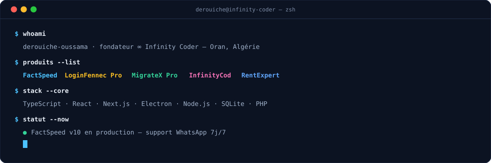
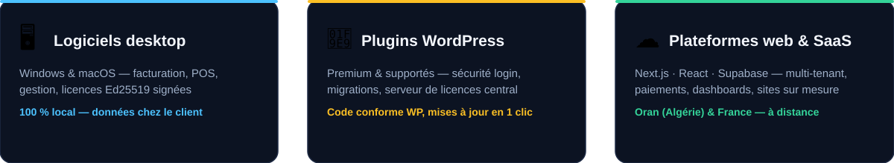

  

  
  
  
  
  
  

  

  

---

## ⭐ Produit phare — [FactSpeed](https://factspeed.com)

> **Facturez à la vitesse de votre commerce.** ERP de facturation & gestion commerciale
> pensé pour l'Algérie — TVA 19/9 %, droit de timbre, G50 & IFU, POS caisse, stock, RH/paie CNAS,
> **100 % local** (données chez le client), Windows & macOS, licence sans abonnement.

  
  
  
  

## 🚀 Écosystème Infinity Coder

| Produit | En une ligne | Lien |
|---|---|---|
| **[FactSpeed](https://factspeed.com)** | ERP facturation Algérie — TVA/timbre, G50, POS, paie CNAS, 100 % local | [releases](https://github.com/derouicheoussama/factspeed-releases) |
| **[LoginFennec Pro](https://github.com/derouicheoussama/loginfennec)** | Sécurité de login WordPress — brute-force, 2FA, audit | repo |
| **[Infinity MigrateX Pro](https://github.com/derouicheoussama/infinity-migratex-pro)** | Migration, sauvegarde & déploiement WordPress par lots | repo |
| **[InfinityCod](https://github.com/derouicheoussama/infinitycod)** | COD Algérie — 58 wilayas, transporteurs, WhatsApp auto | repo |
| **[RentExpert](https://github.com/derouicheoussama/rentexpert)** | ERP location de voitures — GPS Traccar, licences Ed25519 | releases |
| **Infinity License Manager** | Serveur de licences & mises à jour WordPress auto-hébergeable | privé (sur demande) |

🧰 **Open source** — [Windows/Mac Toolbox](https://github.com/derouicheoussama/windows-toolbox) (GPL-3.0) · [Right Click Blocker Pro](https://github.com/derouicheoussama/right-click-blocker-pro) (GPLv2)

## 🧠 Stack

   
  

## 📊 Activité

  
  

  

---

## 📍 Développeur d'applications à Oran, Algérie

Je conçois, développe et maintiens **des logiciels métier pour l'Algérie et la France** :
[logiciel de facturation et de gestion commerciale](https://factspeed.com) (FactSpeed),
[plugins WordPress premium](https://github.com/derouicheoussama/loginfennec) (sécurité, migration, licences),
plateformes SaaS multi-tenant et sites web professionnels sur mesure.
Développement full-stack **TypeScript / React / Electron** pour le desktop et le web,
**PHP / WordPress** pour l'écosystème CMS — données locales ou auto-hébergées, support direct 7j/7.

*EN — Independent full-stack developer from **Oran, Algeria**: desktop invoicing & business
software, premium WordPress plugins, custom multi-tenant SaaS platforms and professional websites.*

  📫 <b>hi@factspeed.com</b> · 💬 <a href="https://wa.me/213770600957">WhatsApp</a> · 🌐 <a href="https://www.derouicheoussama.com">derouicheoussama.com</a>

∞ <b>Infinity Coder</b> — chaque projet signé, chaque client accompagné.

