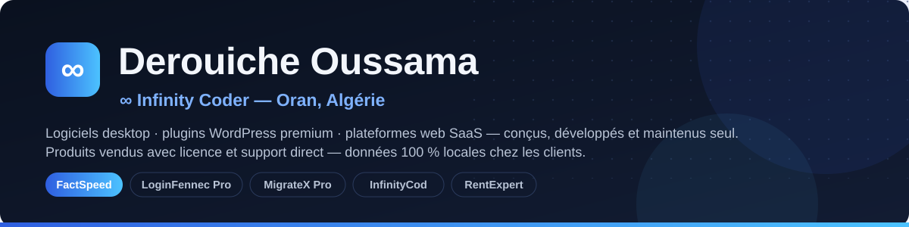

  

# Salut, je suis Derouiche Oussama 👋

**Développeur logiciel indépendant — ∞ Infinity Coder** (Oran, Algérie).
Je conçois, développe et maintiens seul des **logiciels desktop**, des **plugins WordPress**
et des **plateformes web** — pensés pour le marché algérien et vendus avec support direct.

🌐 **Site : [derouicheoussama.com](https://www.derouicheoussama.com)** · **Produit phare : [factspeed.com](https://factspeed.com)** · **Organisation : [github.com/FactSpeed](https://github.com/FactSpeed)**

---

## 🚀 Produits (écosystème Infinity Coder)

| Produit | Quoi | Lien |
|---|---|---|
| **FactSpeed** | ERP de facturation & gestion commerciale pour l'Algérie — TVA & droit de timbre (LF 2025), G50 Excel, POS caisse, RH/paie CNAS, multi-devises, 12 modèles de factures FR/AR RTL, 100 % local (Windows & macOS) | [factspeed.com](https://factspeed.com) |
| **LoginFennec Pro** | Plugin WordPress — personnalisation page login + sécurité (brute-force, honeypot, journal, XML-RPC) | [derouicheoussama/loginfennec](https://github.com/derouicheoussama/loginfennec) |
| **Infinity MigrateX Pro** | Plugin WordPress — migration, sauvegarde & déploiement (moteur par lots, reprise où on s'était arrêté) | [derouicheoussama/infinity-migratex-pro](https://github.com/derouicheoussama/infinity-migratex-pro) |
| **InfinityCod** | Application desktop API transporteurs (11 intégrations), Google Sheets natif, notifications push | [derouicheoussama/infinitycod](https://github.com/derouicheoussama/infinitycod) |
| **RentExpert** | ERP de location de voitures (Algérie) — contrats, GPS Traccar, licences Ed25519, multi-thèmes | [derouicheoussama/rentexpert](https://github.com/derouicheoussama/rentexpert) |
| **Infinity License Manager** | Serveur central de licences & mises à jour WordPress (auto-hébergeable) | privé (sur demande) |

## 🧰 Open source

| Projet | Quoi | Licence |
|---|---|---|
| **[Windows/Mac Toolbox](https://github.com/derouicheoussama/windows-toolbox)** | Utilitaires système : nettoyage, diagnostic, optimisation — PowerShell (Windows) + bash (macOS) | GPL-3.0 |
| **[Right Click Blocker Pro](https://github.com/derouicheoussama/right-click-blocker-pro)** | Protection du contenu WordPress (clic droit, sélection, copie) | GPLv2 |

## 🛠️ Stack

## 📬 Me contacter

- 🌐 Site & portfolio : **[derouicheoussama.com](https://www.derouicheoussama.com)**
- 💼 Produits & licences : **[factspeed.com](https://factspeed.com)**
- 📧 Email : **hi@factspeed.com**

---

∞ **Infinity Coder** — chaque projet signé, chaque client accompagné (WhatsApp 7 j/7).

